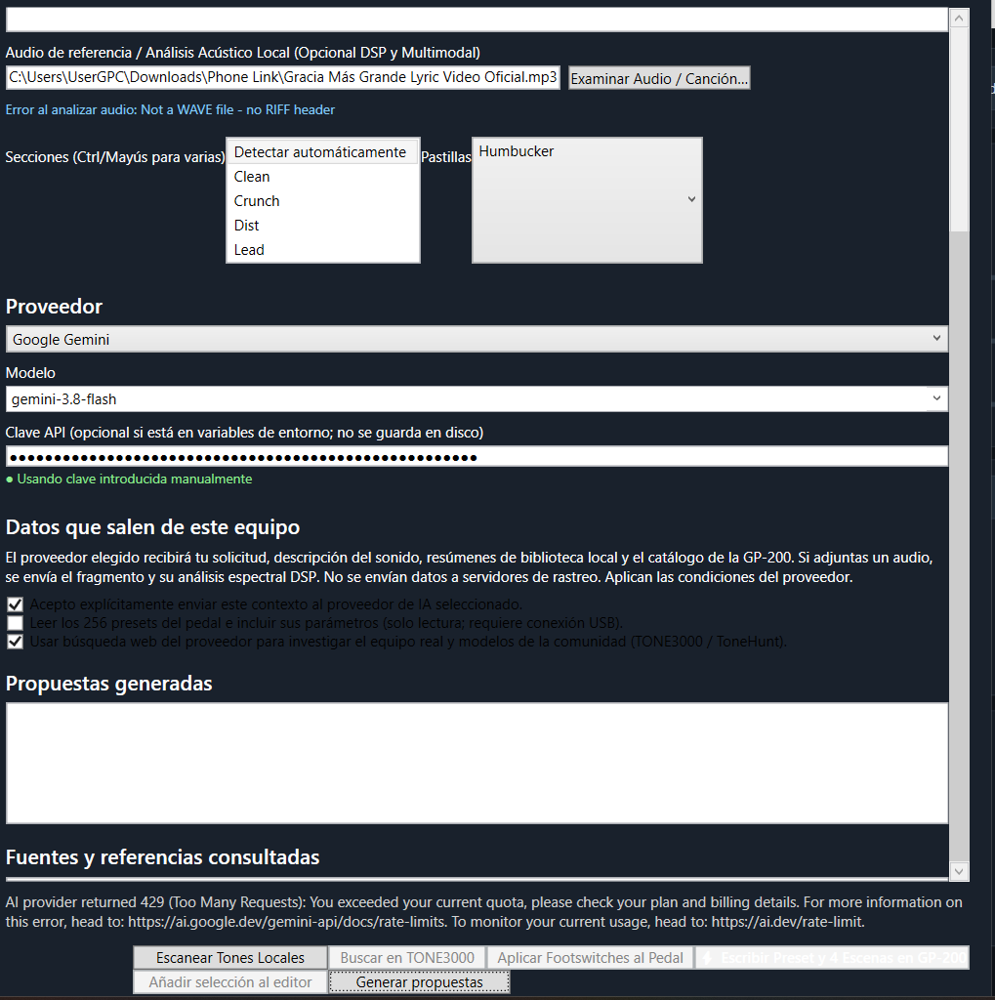
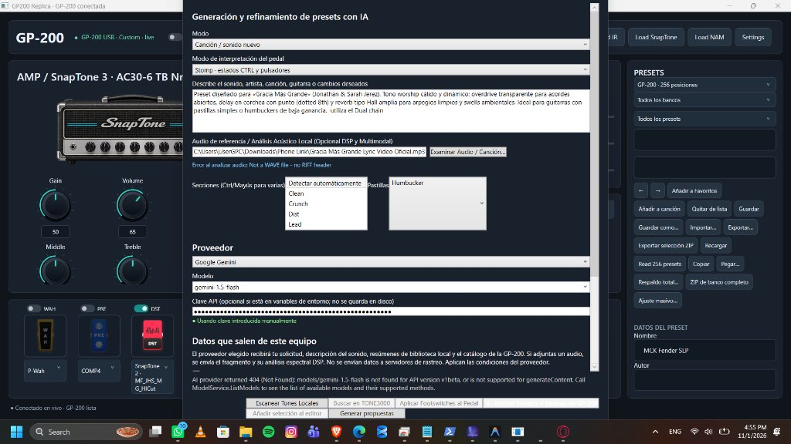
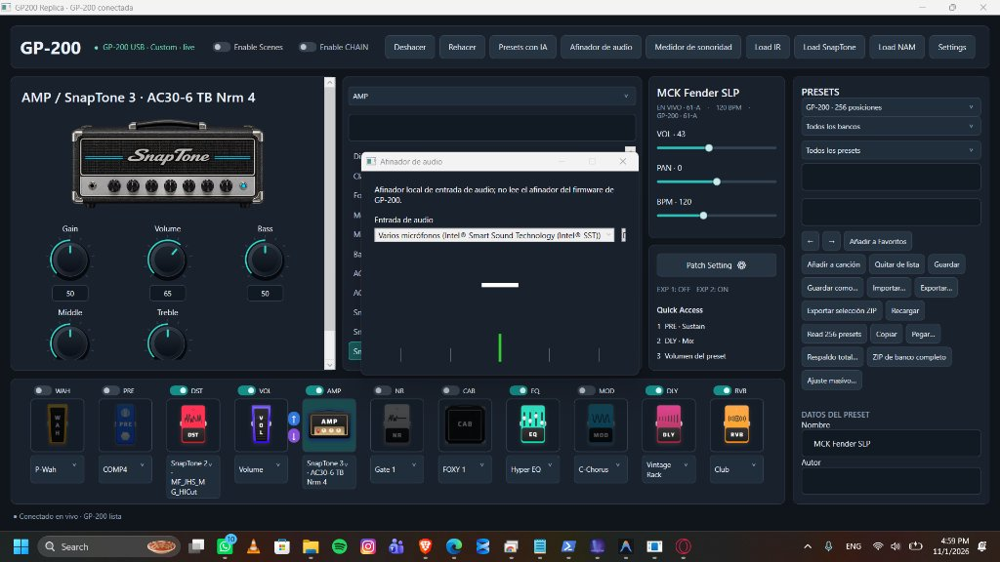

# GP-200 Custom Editor (GP200 Replica)

[]()
[-blue.svg)]()
[]()
[]()
[]()
[-yellow.svg)]()

> ⚠️ **AVISO IMPORTANTE / ESTADO DEL PROYECTO: EN DESARROLLO ACTIVO Y FASE EXPERIMENTAL (WIP / BETA)**
> 
> **Este software se encuentra actualmente en constante desarrollo, ajuste, refinamiento y optimización continua.**
> **Aún NO está en fase de uso definitivo al 100% para presentaciones en vivo ni producción crítica.**
> Si decides probarlo o colaborar, hazlo con precaución y mantén siempre respaldos de tus presets. El proyecto se sigue modificando, arreglando y ampliando día a día con nuevas características de la comunidad.
> 
> *Este proyecto es independiente, impulsado por la comunidad y no cuenta con afiliación oficial con Valeton.*

---

## 📸 Vistas y Capturas del Sistema

| Lienzo Principal & Cadena Dual A/B | Estudio de Generación IA & Inyección en Slots |
| :---: | :---: |
|  |  |

| Afinador de Estudio & VU Meter | Vista General |
| :---: | :---: |
|  |  |

---

## 🚀 Innovaciones y Características Principales

### 1. Revolución Visual & Anti-Flicker (Cero Parpadeo)
- **Actualización Granular en Memoria:** Se eliminó la destrucción completa de la interfaz (`chain.Children.Clear()`). Al hacer clic en un pedal, cambiar bypass o ajustar perillas, el editor conmuta el estado visual directamente en memoria (`SelectModuleInPlace` y `UpdateBlockBypassInPlace`) a **0 ms de latencia**.
- **Tema Oscuro Universal (Dark UI Pro):** ControlTemplates personalizados en C# y WPF que anulan por completo los controles blancos nativos de Aero2 en Windows 11. Aplica a `ComboBox`, `ListBox`, `TextBox`, `TabControl`, `TabItem`, `CheckBox`, `RadioButton`, `ContextMenu` y `MenuItem`.
- **Zoom Global Dinámico:** Escalado por `ScaleTransform` de **75% a 150%** con botones directos en la barra superior (`−`, `100%`, `+`) y atajo `Ctrl + Rueda del ratón`.
- **Navegación Fluida:** Scroll interactivo bidireccional (`PanningMode = Both`) para mouse y touchpad. Ventanas maximizables con agarre de redimensionamiento (`CanResizeWithGrip`).

### 2. Estudio Dedicado de Amplificador ("Amp & Cab Room")
- **Ventana Dedicada (`AmpCabStudioWindow`):** Accesible desde la barra superior y directamente desde el bloque AMP.
- **Cabezal Gráfico:** Perillas gigantes de Gain, Bass, Middle, Treble, Presence y Master/Volume con respuesta en tiempo real.
- **EQ y Dinámica:** Pre/Post Noise Gate interactivo (Threshold/Decay) y ecualizador gráfico/paramétrico de 5 bandas (80 Hz, 400 Hz, 1.6 kHz, 4 kHz, 8 kHz).
- **Microfonía de Cabina:** Modelos de micrófonos (Dyn 57, Ribbon 121, Cond 87, Dyn 421) con filtros ajustables de corte de graves (Low Cut 20-200 Hz), corte de agudos (Hi Cut 3-16 kHz), distancia y mezcla dual A/B.
- **Throttling de 20 ms:** Las perillas envían sus ajustes por MIDI con debouncing de 20 ms para evitar saturar el microcontrolador.

### 3. Slot Morphing & Desbloqueo de 32 Slots NAM
- **Slot Morphing en Cadena:** Menú contextual en cada bloque que permite mutar o intercambiar de posición cualquier módulo (`WAH`, `PRE`, `DST`, `AMP`, `NR`, `CAB`, `EQ`, `MOD`, `DLY`, `RVB`, `VOL`) sin corromper el ruteo interno.
- **Cargador NAM 32 Slots:** Se eliminó el bloqueo de ranuras ocupadas; ahora permite sobrescribir con confirmación y respaldo automático.
- **Inyección Rápida:** Botones de 1 clic para inyectar modelos NAM directamente al bloque `AMP` o `DST`. Permite hasta 2 bloques NAM concurrentes bajo MX42.
- **Puente NamToClo Integrado:** Detección y conversión a modelos SnapTone `.clo` byte-exactos (cabecera `VTSI`, 8840 bytes exactos con CRC16).

### 4. AI Preset Studio 100% Real (Sin Generadores Falsos)
- **Modelos Vigentes de Google Gemini:** Selección por defecto con `gemini-2.5-flash-lite` (mayor cuota gratuita y menor latencia), `gemini-2.5-flash` y `gemini-2.5-pro`.
- **Auto-Fallback Inteligente:** Si un modelo devuelve HTTP 404 (obsoleto o no soportado), el motor reintenta automáticamente con los modelos estables antes de notificar error.
- **Manejo Amigable de Cuotas (429):** Mensajes informativos y orientativos si se agota la cuota gratuita del proveedor.
- **Soporte Multi-Proveedor:** Integración con Anthropic Claude y OpenRouter con almacenamiento cifrado por Windows DPAPI (`ai_config.json`).
- **Analizador Acústico DSP Multi-Formato:** Decodificación universal de archivos `.mp3`, `.wav`, `.m4a` y `.aac` mediante MediaFoundation y NAudio, calculando factor de cresta, balance espectral y BPM sin errores de cabecera RIFF.

### 5. Masterizador de Sonoridad BS.1770 & Afinador de Estudio
- **Nivelador Activo a -14 LUFS:** Captura en tiempo real por WASAPI / PC Loopback y botón `⚡ Auto-Nivelar activo a -14 LUFS`, calculando la desviación exacta en dB y ajustando el volumen en el preset y en la pedalera.
- **Afinador Estroboscópico de Precisión:** Nota gigante, aguja de afinación de alta resolución, medidor de frecuencia en Hz y vúmetro de entrada.

### 6. Protocolo Dual Chain A/B y Seguridad Anti-Brick
- **Ruteo Dual Paralelo A/B:** Gestión de palabras 13 y 14 (`BLEND`, `ALIGN`, `PHASE B · invert`, `Split A/B`) con respaldo automático en memoria y botón `⚡ Sincronizar Cadena en Pedal`.
- **Seguridad Hardware:** Validación estricta de estructura antes de cualquier escritura y copias de seguridad automáticas en disco previas a cada operación física en la GP-200.

---

## 🛠️ Cómo Compilar y Probar en Desarrollo

### Opción Rápida (Recomendada para Probar Código):
Ejecuta el script lanzador incluido en la raíz del repositorio:
```cmd
Run-Editor-From-Source.cmd
```
*Este lanzador compila en modo Debug y arranca la versión local directamente sin modificar ninguna instalación existente.*

### Opción Manual con .NET CLI:
```bash
# Compilar el proyecto
dotnet build Editor\Gp200.Replica.csproj -c Release

# Ejecutar el arnés de 18 pruebas automatizadas
dotnet run --project Editor -c Debug -- --self-test

# Ejecutar la aplicación
dotnet run --project Editor -c Release
```

---

## 🧪 Estado del Arnés de Pruebas (Comprehensive QA Harness)
El proyecto incluye 18 suites de pruebas automatizadas:
```text
[PASS] Catalog MX42 Initialization
[PASS] Universal MIDI Detection & Fallback
[PASS] Granular Parameter Edit Classification
[PASS] MOD Algorithm Catalog Coverage (28 algoritmos)
[PASS] Dual Chain A/B Topology & Words 13/14
[PASS] CloDocument VTSI 8840 Bytes & NamToClo Bridge
[PASS] AudioToneAnalyzer DSP Spectral & Dynamics Engine
[PASS] LoudnessMeter BS.1770 & LoudnessMatcher Auto-Level
[PASS] Mod Capability Scanner & Community Tone Search
[PASS] AI Generation 4 Performance Targets
[PASS] DarkUiTheme Control Templates
[PASS] 100% Real AI Policy, Injection Slot (58-D) & CTRL 8x11 Matrix
[PASS] AudioCaptureEngine Universal Capture & Loopback
[PASS] NamToClo Bridge & Tone Asset Loading Verification
[PASS] Phase 1 Anti-Flicker & Granular In-Place Change Classification
[PASS] Phase 2 Slot Morphing & NAM 32 Slots Limits
[PASS] Phase 3 & 4 Amp/Cab Studio & Mastering Auto-Level Integration
[PASS] Multi-Format Audio Analyzer Robustness (MP3 & WAV)
```

---

## 🤝 Créditos y Agradecimientos
- **Goaltoday:** Arquitectura MIDI/SysEx original, extensiones MX42 y puente NamToClo.
- **Rudy Widmer (GP-200 Studio Web):** Inspiración de diseño interactivo y flujos de trabajo de IA.
- **tntexplosivesltd & Comunidad r/ValetonGP2OO:** Investigaciones de ingeniería inversa y análisis de integridad de firmware.
